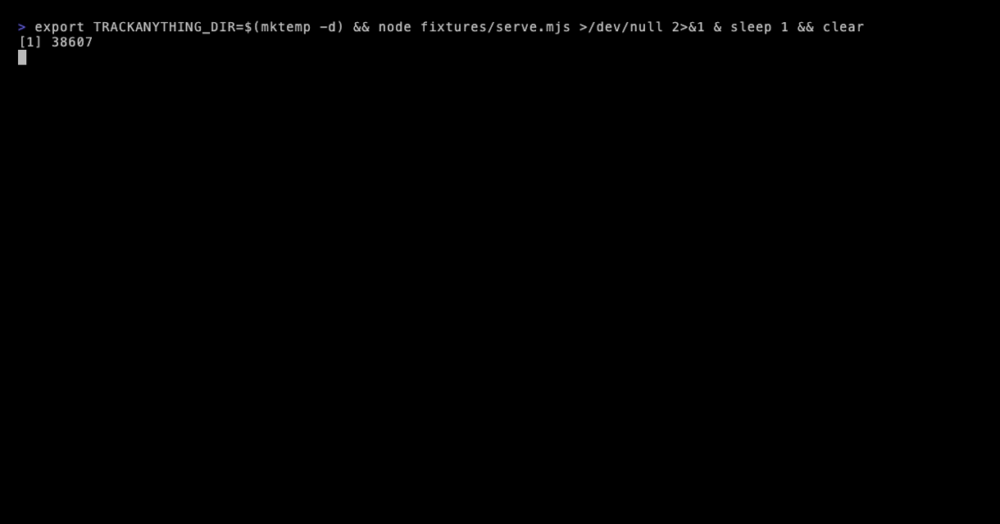

<h1 align="center">trackanything</h1>

<p align="center"><b>Watch the price of anything, on any page, without paying a subscription to do it.</b></p>

<p align="center">
  <code>npx trackanything demo</code> · <a href="#it-usually-needs-no-selector">no selector needed</a> · <code>docker compose up</code>
</p>

<p align="center">
  
</p>

---

Keepa wants $20 a month to remember what things used to cost. This does it on your
own machine, for anything, not just Amazon.

```sh
npx trackanything add https://shop.example/headphones --target 199
npx trackanything check --notify ntfy:my-topic
```

Everything lives in `~/.trackanything/watches.json`. There is no account, no
hosted service, and the only thing it ever connects to is the page you told it to
watch.

## It usually needs no selector

Every other price tracker starts by asking you to right-click, inspect element,
and paste a CSS selector — which then breaks the next time the shop ships a
stylesheet.

It does not have to work that way. Google asks shops to publish their price in
[schema.org](https://schema.org/Product) structured data, so most of them already
do:

```
$ trackanything add https://shop.example/headphones

  Watching Aurora Over-Ear Headphones
  id a1b2c3d4 · £249.99 · read from json-ld
  No selector needed: the page publishes its price in structured data.
```

That number comes from a machine-readable block the shop maintains deliberately.
It does not move when their CSS changes.

The order it tries, and why:

| | Source | Breaks when |
|---|---|---|
| 1 | schema.org JSON-LD | the shop stops caring about Google |
| 2 | OpenGraph / product meta tags | the shop stops caring about link previews |
| 3 | `--selector` you wrote | the shop ships CSS |
| 4 | `--json-path`, for JSON APIs | the API changes |
| 5 | `--regex`, last resort | anything at all |

You only descend that table when you have to:

```sh
trackanything add https://shop.example/desk --selector "#product .now"
trackanything add https://api.shop.example/p/42 --json-path data.product.price
trackanything add https://weird.example/thing --regex "Now only ([\d.]+)"
```

**Find the selector before you commit to it.** `test` fetches and extracts without
saving anything:

```sh
trackanything test https://shop.example/desk --selector "#product .now"
```

And `add` always does one read immediately — a watch that silently cannot see the
page is worse than an error, because you find out six weeks later when the sale
you were waiting for has been and gone.

## Being told

```sh
trackanything check --notify ntfy:my-topic --notify discord:https://…
```

| Channel | Spec |
|---|---|
| ntfy | `ntfy:my-topic` or `ntfy:https://my-server/topic` |
| Discord | `discord:https://discord.com/api/webhooks/…` |
| Slack | `slack:https://hooks.slack.com/…` |
| Any webhook | `webhook:https://…` — gets JSON |
| A local command | `command:notify-send` — gets `$TRACK_*` env vars and stdin |
| Terminal | `stdout` |

All of them are things you already run or that need no account. There is no relay
in the middle, because a price tracker that phones a company to tell you a price
dropped has given away the thing you were avoiding.

Choose *when* with `--on`:

- `change` (default) — any move
- `drop` — only down, plus back-in-stock
- `target` — once, when it crosses the price you would actually buy at
- `stock` — only back-in-stock
- `never` — record it, say nothing

```
Aurora Over-Ear Headphones dropped 28% to £179.99, the lowest it has been (was £249.99)
```

## Keeping it running

Not a daemon. One pass, then it exits — which is one less thing to keep alive.

```sh
# crontab -e
0 */6 * * * npx trackanything check --notify ntfy:my-topic --quiet
```

Or in Docker:

```sh
docker compose up                          # one pass
docker compose --profile cron up -d        # a loop, if you would rather
```

`--every 6h` on a watch is a floor, not a schedule: run `check` as often as you
like and each watch is only actually fetched when its own interval has elapsed.
Concurrency is capped at three, because twenty parallel requests to one shop is
how you get blocked.

## The report

```sh
trackanything report prices.html
```

<p align="center">
  
</p>

One self-contained file — no JavaScript, no remote requests, nothing to host. The
charts are **step charts**, because a price is a step function: it was £449 until
Tuesday and then it was £389, and joining those with a diagonal would draw a week
of prices nobody was ever charged.

## See it without watching anything

```sh
npx trackanything demo
```

Six months of invented history for an invented shop, and it fetches nothing. The
test suite asserts that — the demo is given a `fetch` that throws.

## History that does not grow forever

A watch checked every six hours for a year is 1,460 readings, and 1,455 of them
say the same thing. So identical consecutive readings extend the existing point
rather than appending a new one:

```json
{ "value": 249.99, "from": "2026-03-01T…", "to": "2026-05-14T…", "checks": 296 }
```

Which is both the truth — *it was £249.99 for eleven weeks* — and the reason the
file stays small enough to keep in a git repo if you want to.

## When it fails

It will. Shops put pages behind bot checks, change their markup, and geo-redirect.
So failures are recorded as data rather than thrown:

```
  ! Larkin Standing Desk    selector "#product .now" matched nothing with a number in it
  ⊘ Aurora Headphones       blocked — the site refused the request (HTTP 403)
```

The history is untouched, the other watches still run, and `list` shows the error
next to the watch until the next successful read.

**On being polite.** It sends a normal browser User-Agent, because a lot of CDNs
serve a challenge page to anything that looks scripted and a challenge page has no
price on it. That is the extent of it: no proxy rotation, no headless browser, no
CAPTCHA solving. If a shop genuinely does not want to be read, this will not read
it, and that is the correct outcome.

## When a shop blocks you

Some shops answer a script with an anti-bot wall instead of the page — a `403`, or
a `200` that is really a "Just a moment…" interstitial with no price on it. Because
a wall is not the same failure as a broken selector, it is handled differently, and
the handling is built around *respecting* the block, not getting past it.

**It is named for what it is.** A wall is reported as `blocked` (marked `⊘`, in
amber), not as a missing price, so you are not sent off writing a selector for a
page that was never served to you.

**It backs off instead of knocking harder.** The first block holds that watch for
an hour; the next for two, then four, doubling up to a daily cap. A site that is
refusing you is left alone — and retried once a day in case the block lifts —
rather than hit on every run. `list` shows when it will next try:

```
  a1b2c3d4  Aurora Headphones   £249.99   blocked — HTTP 403   retrying 2026-10-13 14:00
```

**You can read a site as yourself.** If you have a genuine account somewhere, copy
your own `Cookie` header out of your browser and hand it over — now trackanything
reads the page logged in as you, which is you using your own access, not a tool
pretending to be someone it isn't:

```sh
trackanything add https://shop.example/members-only \
  --cookie "session=…; cart=…" \
  --header "Referer: https://shop.example/"
```

Those headers are stored in plain text in `watches.json`, so treat that file the
way you would treat anything else holding a session cookie.

What it will not do, by design, is solve a CAPTCHA, rotate proxies or spoof a
browser it is not. The moment a price tracker becomes an evasion tool it stops
being something you can point at honestly — and a block you cannot read as yourself
is the shop's answer, which is allowed to be no.

## Everything else

```
trackanything list                     what you are watching
trackanything history <id|name>        every price it has been
trackanything pause|resume <id|name>
trackanything remove <id|name>
```

Watches are found by id, by name, or by any fragment of either — `trackanything
history headphones` works.

## Contributing

```sh
npm test    # 62 tests, no dependencies, no network
```

The most useful contributions:

1. **A page it cannot read.** Add it to `fixtures/pages.mjs` with the shape that
   defeated it, and the extractor grows a case.
2. **A notification channel** — one function in `src/notify/index.mjs`.
3. **A number format that parses wrong.** `parseAmount` handles both hemispheres
   of decimal punctuation; if yours is a third, that is a bug with a test attached.

MIT. Fork it, rename it, ship it.
